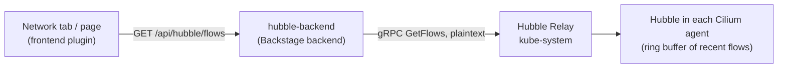

# How it works

## Backend

`GET /api/hubble/flows` takes `namespace`, `workload`, repeated `verdict` and `limit`. It asks Relay for the last `limit` flows
that match and reduces each `Flow` message to what a person reads.

- `workload` matches flows **from or to** the workload: two filters, because Hubble ORs separate filters and ANDs the fields within one.
- Inputs are validated (`workload` and `namespace` must look like Kubernetes names, verdicts come from a fixed list, `limit` is capped by `hubble.maxFlows`).
- Only signed-in users may call it: flows name every workload and its peers.
- `GET /api/hubble/status` returns Relay's buffer size and version.

The Hubble `.proto` files are vendored unchanged from Cilium `v1.20.2` (`plugins/hubble-backend/proto`).

## Frontend

Written for Backstage's new frontend system: an `ApiBlueprint` for the client, an `EntityContentBlueprint` that adds the **Network**
tab to entities with a Kubernetes selector annotation, and a `PageBlueprint` for the namespace-wide page. The tab takes the
workload name from `backstage.io/kubernetes-label-selector` (`app.kubernetes.io/name=<name>`) and the namespace from
`backstage.io/kubernetes-namespace`.
